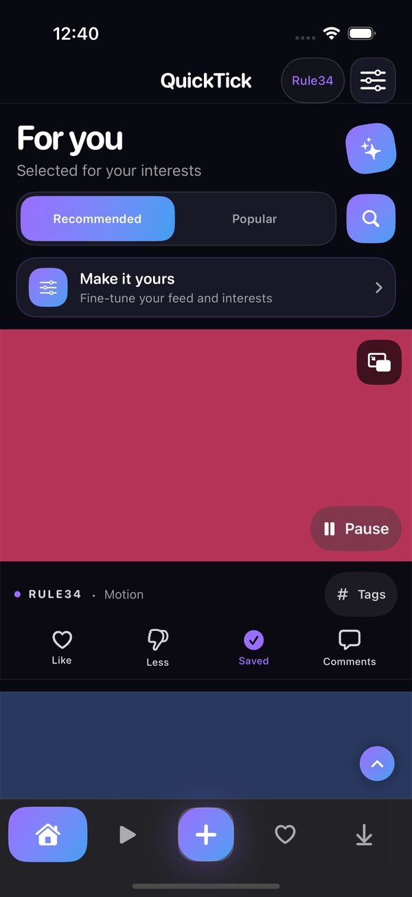
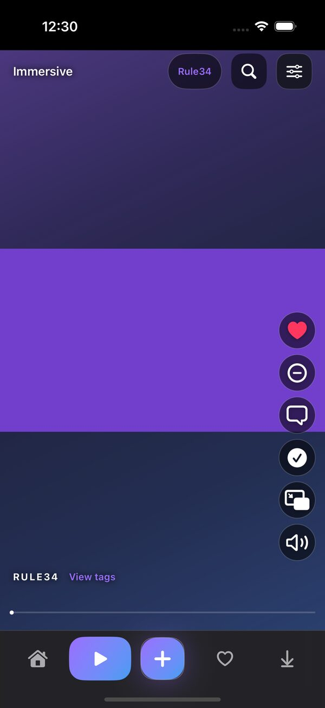
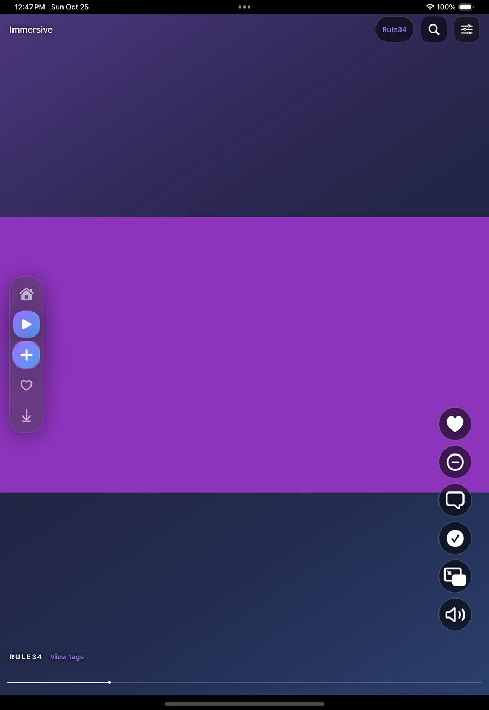

# QuickTick

**Native media discovery for iPhone and iPad.** Browse, discover, save and revisit media with a customizable SwiftUI interface, an immersive player, on-device recommendations and an optional local image studio.

  

**Current development version:** v1.0 (build 30). The previously verified v0.9.9 (build 29) source was merged into `main` on October 25, 2026. Its [successful iOS workflow](https://github.com/Robertloggiar34yyeeez/QuickTick/actions/runs/40188749487) built an unsigned IPA and completed its automated iPhone/iPad tests. Real-device performance, model compatibility and external content availability vary and are not guaranteed by CI.

## Screenshots

| Home · For You | Immersive · iPhone | Immersive · iPad |
| :---: | :---: | :---: |
|  |  |  |

These are **actual iOS Simulator screenshots** exported from the successful UI-test run. The media areas contain synthetic test colors, not personal downloads, account data or browsing history.

## What is included

- **For You feed:** A native Home feed with Recommended/Popular modes, search, sorting, tag include/exclude controls, likes, dislikes and history-aware discovery.
- **Visual Taste recommendations:** Local preference learning combines saved interests, interaction signals, semantic text embeddings and visual/tag information. Ranking includes exploration and diversity safeguards to reduce repetitive recommendations; relevance is still a work in progress.
- **Immersive viewing:** Swipe-driven full-screen browsing with playback controls, favorites, quick feedback, gesture and paging fixes, adaptive iPhone/iPad layouts and a vertically scrollable comic viewer.
- **Favorites and Downloads:** Save media for an offline feed, revisit liked posts, see download progress and share/export a recommendation profile.
- **Rhythm and floating playback:** Optional rhythm sessions for Likes and Downloads with changing Regular/Duo/Triple/Quad phrases, automatic media shuffling, and a floating video player.
- **On-device Create:** An optional image generation tab with local model management, aspect ratios, prompting assistance, model/LoRA discovery, Anima Metal support paths and compatible upscaling. Large models require capable hardware; some model/LoRA combinations remain experimental.
- **Personalization:** Themes including cosmic variants, playback settings, recommendation rescans and an option to hide the Create tab.

## Install an IPA

1. Open [GitHub Actions → Native iOS build and IPA](https://github.com/Robertloggiar34yyeeez/QuickTick/actions/workflows/ios.yml) and choose a **successful** run for `main`.
2. Under **Artifacts**, download `QuickTick-1.0-unsigned-IPA` from a v1.0 run (while retained by GitHub Actions).
3. Extract the archive and sign/sideload the included `.ipa` using a compatible installation method. The IPA is **unsigned**; it will not install directly like an App Store app.

GitHub Actions artifacts are temporary (currently retained for 14 days). This repository does not promise a permanent binary download or App Store distribution. To build from source, open `ios-starter/QuicktickNative.xcodeproj` with a compatible Xcode release on macOS; see [the iOS workflow](.github/workflows/ios.yml) for the exact build pipeline.

## Development and privacy

- Requires iOS 17 or later; implemented with SwiftUI/UIKit, AVFoundation and on-device model components.
- Recommendations and media libraries are designed to work locally. Provider availability, authorization requirements and regional restrictions still apply.
- Credentials, signing keys, local profile exports and personal media must **not** be committed to this public repository. The screenshots above are synthetic UI-test fixtures.
- Native source lives in [`ios-starter/`](ios-starter/). For implementation details see [architecture](ARCHITECTURE.md), [image studio notes](ios-starter/IMAGE_STUDIO.md) and [recommendation design](ios-starter/RECOMMENDER-DESIGN.md).

QuickTick is an independently developed project. Content from third-party services remains subject to their access rules and rights; the project does not include or license that content.
